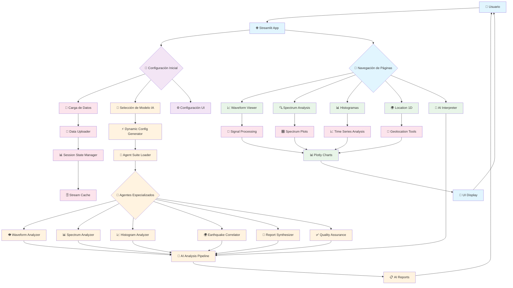
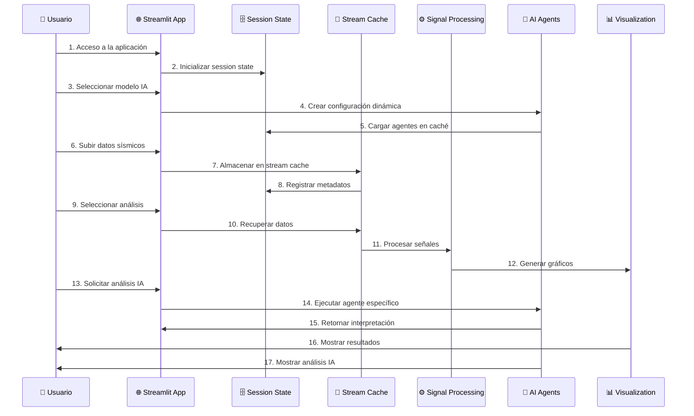
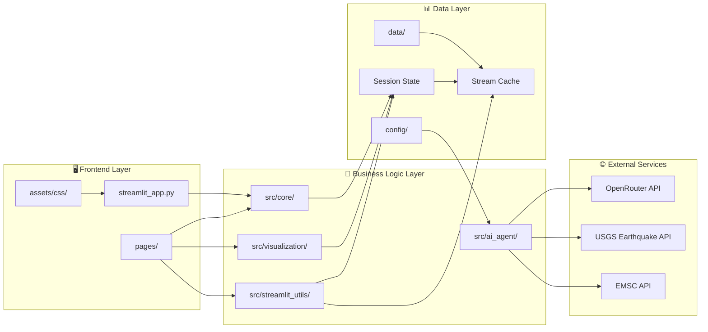
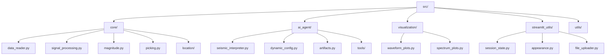
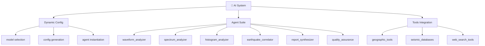
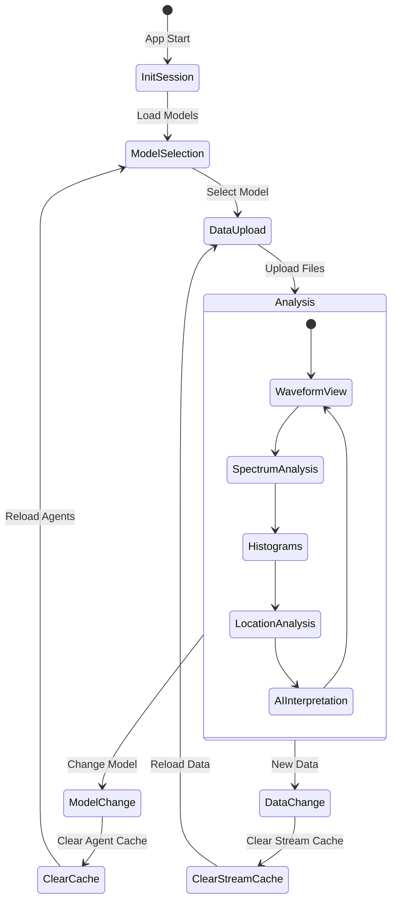
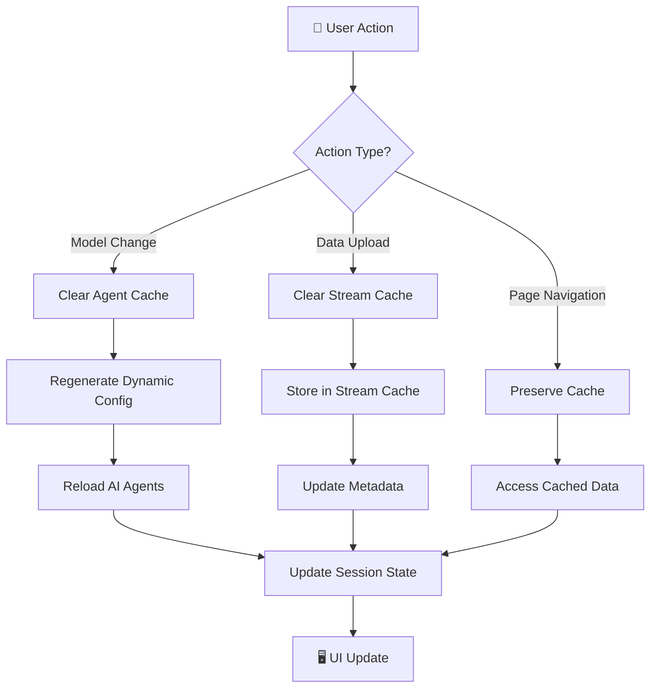
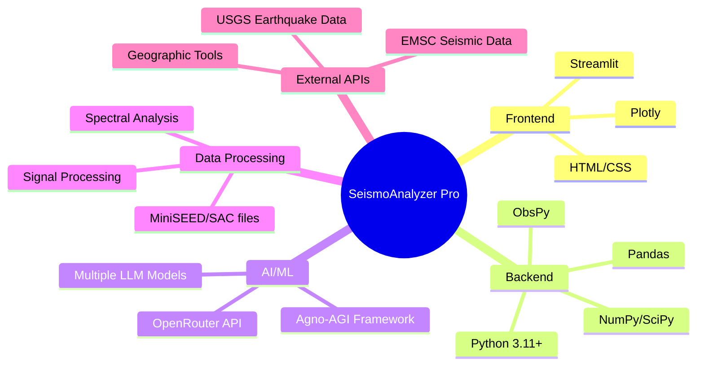

# 🏗️ Diagrama de Arquitectura - SeismoAnalyzer Pro

## 📊 Flujo Principal de la Aplicación

## 🔄 Flujo de Datos Detallado

## 🏗️ Arquitectura de Componentes

## 🔧 Componentes Principales

### 📁 **Frontend (`streamlit_app.py` + `pages/`)**
- **streamlit_app.py**: Punto de entrada principal
- **pages/**: Páginas individuales de análisis
- **assets/css/**: Estilos y temas visuales

### 🧠 **Core Logic (`src/`)**

### 🤖 **Sistema de IA**

## 📊 **Flujo de Session State**

## 🔄 **Cache Management**

## 🛠️ **Tecnologías y Dependencias**

Este diagrama muestra la arquitectura completa de la aplicación, desde la entrada del usuario hasta la generación de análisis IA, incluyendo el manejo de datos, caché, y la integración de múltiples componentes especializados.